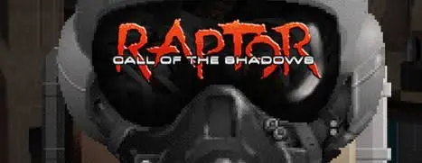

# Raptor Web

Raptor: Call of the Shadows, running in your browser. This is a WebAssembly port of
[skynettx/raptor](https://github.com/skynettx/raptor), with smooth frame interpolation
(60 FPS by default, up to 144 FPS or your monitor's refresh rate) and a widescreen presentation.

**Play:** https://arielkuzminski.github.io/raptor-web/

<p align="center"></p>

[Watch the demo video (webm)](docs/raptor.webm)

## You need your own game files

This project does not contain and does not host any game data. You need the original GLB files from
Raptor: Call of the Shadows:

- Shareware: `FILE0000.GLB` and `FILE0001.GLB`
- Full version 1.2 or higher: `FILE0000.GLB` to `FILE0004.GLB`

Select them on the start screen. They are stored only in your browser (IndexedDB) and are never uploaded anywhere.
Older versions before 1.2 are not compatible.

## Features

- Runs in a modern browser, no installation.
- Smooth motion: the game logic keeps its original timing, and rendering is interpolated between steps.
  Choose 60, 120, 144 FPS or match your monitor.
- 16:9 presentation with a blurred copy of the game on the sides.
- Fullscreen from the button or with Alt+Enter.
- Text in English (default) and Polish. Other languages can be added as `lang/<code>.lng` files.
- Saves and settings are kept in the browser.

## Controls

| Key | Action |
|---|---|
| Arrows | Move |
| Ctrl | Fire |
| Alt | Special weapon |
| Space | Change weapon |
| Alt+Enter | Fullscreen |
| Escape / P / Enter | Menu / pause / confirm (touch pad buttons) |

On touch screens an on-screen pad appears: a joystick on the left, FIRE, SPECIAL, MEGA and CHANGE on the right.
The page also opens with `?touch=1` to show the pad on any device. A gamepad is detected by the browser and works in the game's own mapping.

## Build the web version

You need [Emscripten](https://emscripten.org/) (emsdk). On Windows, run the build in WSL (Debian).
On Linux or macOS, run it directly.

```bash
bash web/build_web.sh
```

The output goes to `web/dist/`. Serve it locally:

```bash
cd web/dist
python -m http.server 8090 --bind 127.0.0.1
```

Then open http://127.0.0.1:8090/. The build script uses `emcc` from `PATH` if it is available,
otherwise it looks for emsdk in `~/tools/emsdk`.

To skip picking files in the browser, put your GLB files in `web/dist/data/`. The page loads them automatically.
Never commit game data.

Pushes to the `web` branch are deployed to GitHub Pages by `.github/workflows/pages.yml`.

## Native build

The native (Windows, Linux, macOS, Android) build is unchanged from the original project.
See the [original README](https://github.com/skynettx/raptor#readme) for instructions.

## Credits

- Based on the reverse-engineered source code by [nukeykt](https://github.com/nukeykt) and
  [wel97459](https://github.com/wel97459), and the port by [skynettx](https://github.com/skynettx/raptor).
- TinySoundFont by [schellingb](https://github.com/schellingb) and libtextscreen from the
  [chocolate-doom project](https://github.com/chocolate-doom), as in the original.
- Raptor: Call of the Shadows and its data files belong to their rights holders. This project is not
  affiliated with them and does not distribute their files.

## License

Raptor Web is licensed under the [GPLv2](LICENSE) or later, the same as the original project.
Changes made for the web version are in the `web` branch.
